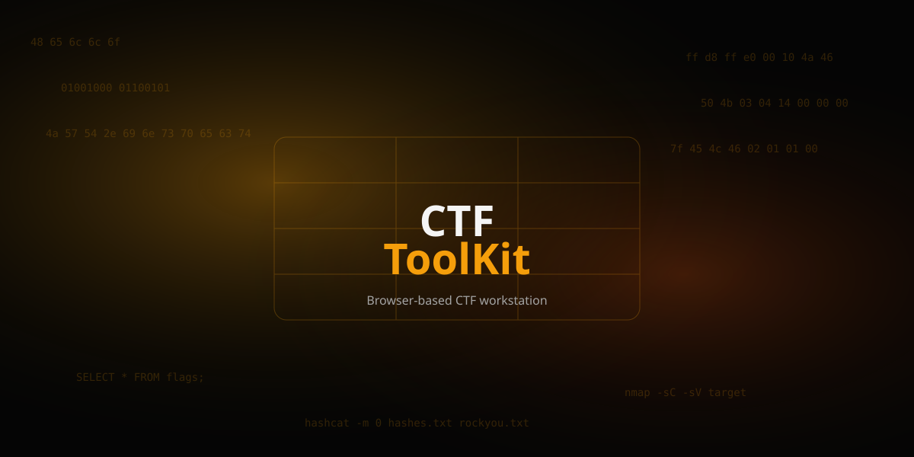

# CTFToolKit




Offline-first CTF web toolkit. Vite + React + TypeScript. Static PWA deployed to Vercel.

## Development

```bash
npm install
npm run dev
npm run lint
npm run typecheck
npm test
npm run build
```

## Installation (native tools)

```bash
curl -fsSL https://raw.githubusercontent.com/Rishi-Sejpal/CTFToolKit/main/install.sh | bash -s -- --profile full
```

Safer:

```bash
curl -fsSLo install.sh https://raw.githubusercontent.com/Rishi-Sejpal/CTFToolKit/main/install.sh
bash install.sh --dry-run --profile full
bash install.sh --profile full
```

## Uninstall

```bash
bash uninstall.sh --dry-run
bash uninstall.sh --yes
```

## Offline

First visit downloads assets; afterwards works offline via service worker.

## Licensing

Original code MIT. See LICENSE, THIRD_PARTY_NOTICES.md.
